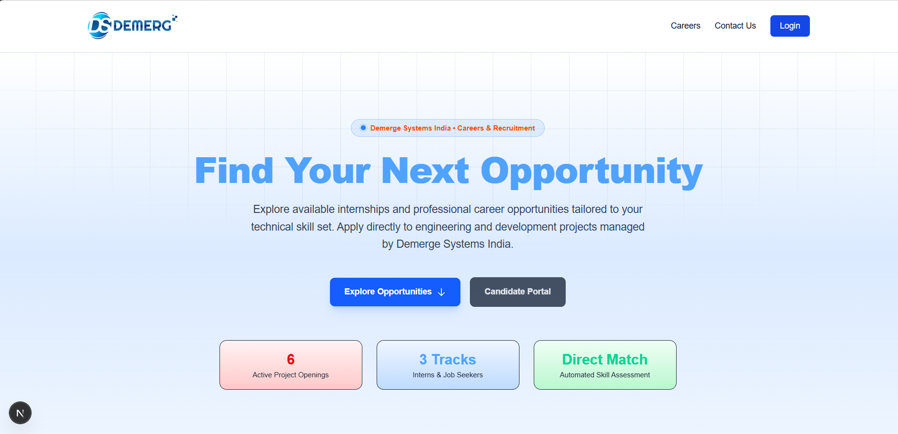
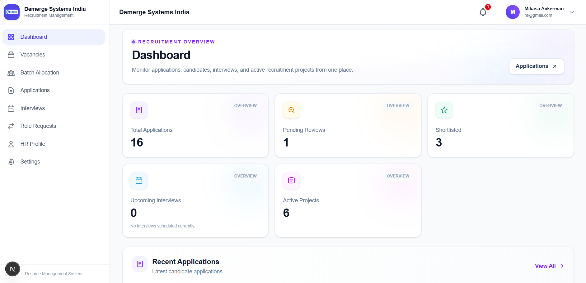
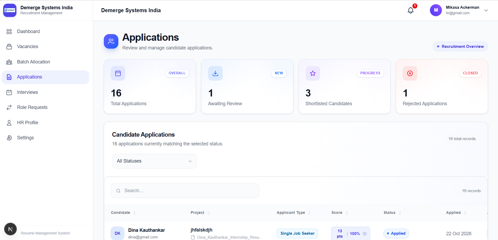
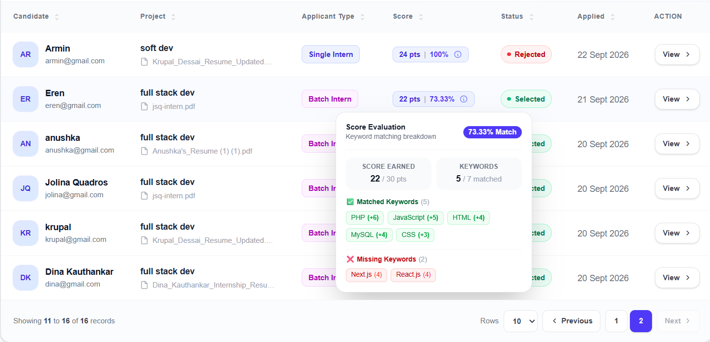
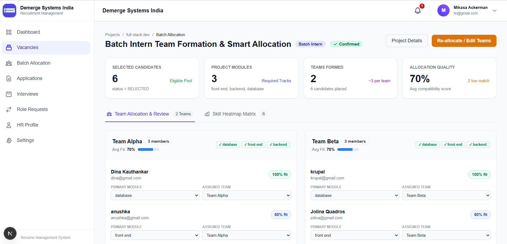
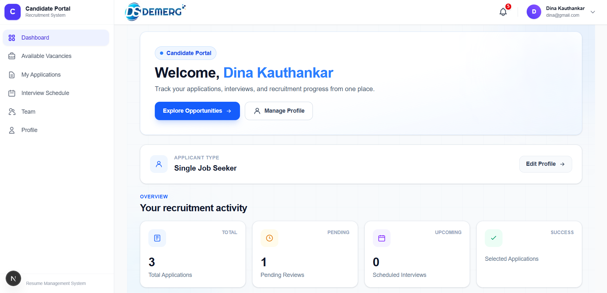
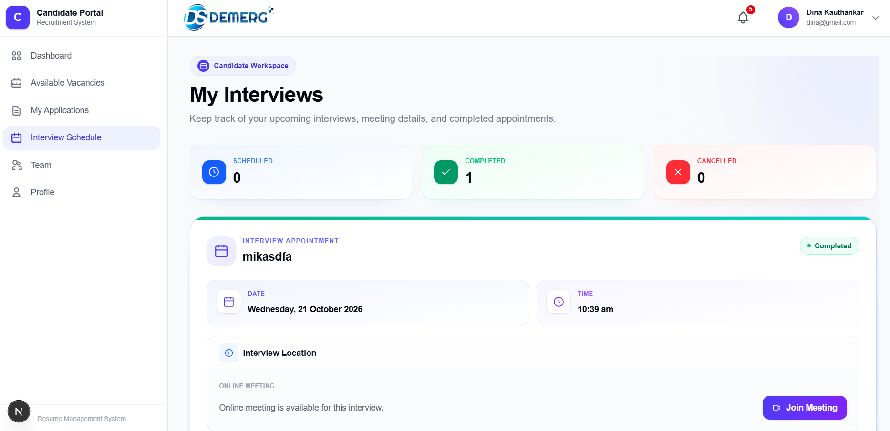
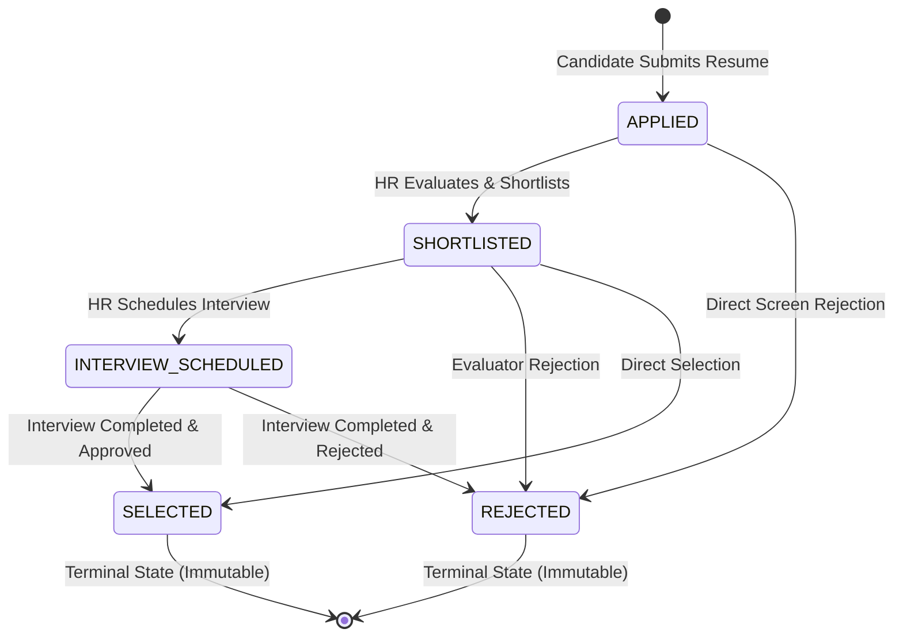

# 📄 Resume Management & Smart Task Allocation System

[](https://nextjs.org/)
[](https://react.dev/)
[](https://www.typescriptlang.org/)
[](https://tailwindcss.com/)
[](https://www.mysql.com/)
[](#)

> An enterprise-grade, deterministic talent acquisition platform featuring **in-memory multi-format resume parsing (PDF, DOCX, LaTeX)**, **weighted keyword matching**, and an **NP-hard resolving Two-Stage Heuristic Team Allocation Engine** for batch internship cohorts.

---

## 📌 Table of Contents

- [Overview](#-overview)
- [Key Features](#-key-features)
- [System Architecture](#-system-architecture)
- [Screenshots & UI Walkthrough](#-screenshots--ui-walkthrough)
- [Core Algorithms](#-core-algorithms)
  - [1. Weighted Keyword Matching & Confidence Scoring](#1-weighted-keyword-matching--confidence-scoring)
  - [2. Two-Stage Batch Allocation Engine](#2-two-stage-batch-allocation-engine)
- [State Machine & Recruitment Lifecycle](#-state-machine--recruitment-lifecycle)
- [Database Schema (15 Relational Tables)](#-database-schema-15-relational-tables)
- [Technology Stack](#-technology-stack)
- [Getting Started](#-getting-started)
  - [Prerequisites](#prerequisites)
  - [Installation & Setup](#installation--setup)
  - [Environment Variables](#environment-variables)
  - [Database Initialization](#database-initialization)
  - [Running the Application](#running-the-application)
- [Project Directory Structure](#-project-directory-structure)
- [Security & Data Integrity](#-security--data-integrity)
- [API Route Catalogue](#-api-route-catalogue)
- [Author & Acknowledgments](#-author--acknowledgments)

---

## 🚀 Overview

The **Resume Management & Smart Task Allocation System** was engineered for **Demerge Systems India** to solve the primary operational bottlenecks in technical recruiting: evaluation fatigue, heterogeneous document formats, subjective scoring, and the mathematically complex task of assembling balanced engineering squads from large internship batches.

### Core Innovations:
- **Zero Third-Party AI Dependencies**: Native TypeScript text extraction and mathematical scoring eliminates external API costs, latency, privacy risks, and LLM hallucinations.
- **Heterogeneous In-Memory Ingestion**: Directly parses, sanitizes, and normalizes PDF, Microsoft Word (`.docx`), and raw LaTeX source files (`.tex`).
- **Deterministic Evaluation**: Custom integer-weighted keyword matching yields consistent absolute scores and confidence percentages.
- **Explainable Two-Stage Team Formation**: Automatically partitions batch interns into balanced squads and allocates project modules based on demonstrated skill sets using snake round-robin distribution.

---

## ✨ Key Features

### 🏢 Human Resources Management Portal
- **Executive Analytics Dashboard**: Real-time metrics tracking total applications, pending evaluations, shortlisted candidates, and active vacancies.
- **Dynamic Vacancy & Keyword Configurator**: Create vacancies tailored to specific applicant types, define modules, and assign custom integer importance weights (1–10) to technical keywords.
- **Advanced Headless Data Table**: Powered by `@tanstack/react-table` with multi-column sorting, pagination, status filtering, and fast keyword search.
- **Granular Candidate Evaluation View**: Inspect match breakdowns (earned score, max score, confidence %, matched vs. missing keywords with individual weights), stream resumes inline, and review full status audit trails.
- **Interview Coordination System**: Schedule and manage Online (with meeting URLs) and Offline (with physical venue auto-resolution from enterprise settings) appointments.
- **Two-Stage Batch Allocation Workspace**: View candidate-module skill compatibility heatmaps, generate squad recommendations, manually adjust assignments, and transactionally commit allocations.
- **Candidate Role-Change Review**: Review and approve/reject applicant type migration requests with audit notes.
- **Enterprise Settings & Dynamic Branding**: Configure company logo, brand color, recruitment contacts, allowed file formats, and upload size thresholds.

### 🎓 Candidate Portal
- **Personalized Candidate Dashboard**: Real-time overview of submitted applications, earned scores, review states, and scheduled interviews.
- **Role-Aware Vacancy Discovery**: Vacancy feed strictly filtered by candidate category (`SINGLE_JOB_SEEKER`, `SINGLE_INTERN`, `BATCH_INTERN`).
- **Streamlined Application Ingestion**: Client-side format/size validation with instant feedback on submission.
- **Transparent Score Breakdown**: View match confidence and inspect missing vs. matched competencies.
- **Interview Schedule Hub**: View confirmed interview timings, meeting links, or physical headquarters venue details.
- **Batch Intern Squad Dashboard**: Interactive squad view showing team name, assigned project module, module specs, and fellow teammates with their assigned roles.
- **Job Role Migration Workflow**: Formal request mechanism to transition applicant categories without corrupting historical records.

---

## 🏛 System Architecture

The application adheres to a clean, multi-tier enterprise architecture ensuring strict separation of concerns and ACID-compliant transactional consistency:

```
+-------------------------------------------------------------------------+
|                         PRESENTATION LAYER                              |
|   Next.js 16 (React 19) Server & Client Components | Tailwind CSS v4    |
|   TanStack Headless Table | Responsive Navigation Shells | Sonner Toast |
+-------------------------------------------------------------------------+
                                     │
                             HTTP / HTTPS (Fetch)
                                     │
+-------------------------------------------------------------------------+
|                     EDGE & ROUTING CONTROLLERS                          |
|   middleware.ts (Edge RBAC Route Guard with jose JWT Verification)      |
|   App Router API Handlers (/app/api/**) | DTO Validation Schemas        |
+-------------------------------------------------------------------------+
                                     │
                              Service Calls
                                     │
+-------------------------------------------------------------------------+
|                         DOMAIN SERVICE LAYER                            |
|   - Document Extraction & Text Cleaning (PDF, DOCX, LaTeX)              |
|   - Weighted Keyword Matching & Confidence Engine                       |
|   - Two-Stage Heuristic Batch Allocation & Heatmap Engine               |
|   - State Machine Guard Rules & Interview Logistics Service             |
|   - Nodemailer Email Service (CSPRNG OTP Dispatch)                      |
+-------------------------------------------------------------------------+
                                     │
                           Repository Invocations
                                     │
+-------------------------------------------------------------------------+
|                     DATA ACCESS LAYER (REPOSITORIES)                    |
|   Parameterized SQL Queries | Connection Pool Management (mysql2)       |
|   InnoDB ACID Transaction Boundaries (Begin / Commit / Rollback)        |
+-------------------------------------------------------------------------+
                                     │
                              Pool Connections
                                     │
+-------------------------------------------------------------------------+
|                        PERSISTENCE LAYER (MySQL 8)                      |
|   15 Normalized Relational Tables | Referential Constraints & Cascades  |
+-------------------------------------------------------------------------+
```

---

## 📸 Screenshots & UI Walkthrough

| View | Screenshot |
| :--- | :--- |
| **Landing page**<br>the landing page. |  |
| **HR Recruitment Dashboard**<br>Recruitment metrics, candidate pipeline stats, and recent submission logs. |  |
| **Applicant Evaluation Table**<br>TanStack powered candidate management table with status tags and score badges. |  |
| **Granular Keyword Evaluation Modal**<br>Matched vs. missing keyword weight breakdown and resume document streamer. |  |
| **Batch Allocation & Heatmap Workspace**<br>Skill compatibility heatmap, two-stage squad builder, and module coverage alerts. |  |
| **Candidate Dashboard & Team Roster**<br>Application tracking, interview appointments, and batch squad module roster. |  |
| **Interview Coordination & Scheduling**<br>Online/Offline appointment scheduler with automatic enterprise address derivation. |  |

---

## 🧮 Core Algorithms

### 1. Weighted Keyword Matching & Confidence Scoring

Rather than relying on opaque probabilistic models, candidate evaluation uses a deterministic weighted keyword matching algorithm ($O(n \times m)$ string search over normalized Unicode text).

Let:
- $R$ be the normalized resume text string: $\text{norm}(R) = \text{trim}(\text{lowercase}(\text{collapse\_spaces}(R)))$
- $K = \{k_1, k_2, \dots, k_n\}$ be the vacancy's configured keywords
- $w_i \in \mathbb{N}_{\ge 1}$ be the positive integer weight for keyword $k_i$

The binary match indicator $m_i$ for keyword $k_i$ is defined as:
$$m_i = \begin{cases} 1 & \text{if } \text{norm}(k_i) \subseteq \text{norm}(R) \\ 0 & \text{otherwise} \end{cases}$$

1. **Earned Absolute Score ($S$)**:
   $$S = \sum_{i=1}^{n} (m_i \times w_i)$$

2. **Maximum Possible Score ($S_{\max}$)**:
   $$S_{\max} = \sum_{i=1}^{n} w_i$$

3. **Percentage Confidence Score ($C$)**:
   $$C = \begin{cases} 0.00 & \text{if } S_{\max} = 0 \\ \text{round}\left( \frac{S}{S_{\max}} \times 100, 2 \right) & \text{if } S_{\max} > 0 \end{cases}$$

---

### 2. Two-Stage Batch Allocation Engine

Assigning $N$ selected batch interns to $K$ balanced engineering squads and distinct functional project modules (e.g., *Frontend UI, Backend API, Database Architecture, Machine Learning, DevOps*) is an NP-hard combinatorial problem. The system executes an explainable two-stage heuristic algorithm:

```
                  [ Eligible Candidates Pool ]
             (applications.status = 'SELECTED' AND
           applications.applicant_type = 'BATCH_INTERN')
                                │
                                ▼
         [ Compute Candidate-Module Compatibility Matrix ]
             C(c, m) = (Matched Skills / Total Skills) * 100
                                │
                                ▼
           [ STAGE 1: BALANCED TEAM SQUAD FORMATION ]
           - Determine Primary Module for each candidate
           - Group candidates by Primary Module
           - Sort by compatibility in descending order
           - Distribute via Snake Round-Robin balancing:
               Team 1 -> Team 2 -> ... -> Team K
               Team K -> Team K-1 -> ... -> Team 1
                                │
                                ▼
         [ STAGE 2: OPTIMAL MODULE ASSIGNMENT PER SQUAD ]
           - For each team, sort modules by squad average compatibility
           - Assign best unassigned member to each module
           - Assign surplus members to their peak proficiency module
           - Flag LOW_COMPATIBILITY (< 60%) & UNCOVERED_MODULE warnings
                                │
                                ▼
           [ HR Verification & Atomic MySQL Commit ]
```

---

## 🔄 State Machine & Recruitment Lifecycle

Recruitment applications transition through an auditable, strictly guarded state machine:



### Business Guard Invariants:
- **Terminal Decision Immutability**: Applications in `SELECTED` or `REJECTED` state are permanently frozen and cannot be altered.
- **Active Interview Guard**: An application with an interview in `SCHEDULED` status cannot transition to `SELECTED` or `REJECTED` until the interview is explicitly marked `COMPLETED` or `CANCELLED`.
- **Shortlisting Precondition**: Interviews can only be scheduled for applications in `SHORTLISTED` status.
- **Immutable Audit Trail**: Every status modification automatically records an entry in `application_status_history` capturing `old_status`, `new_status`, `changed_by` (HR ID), `decision_note`, and timestamp.

---

## 🗄 Database Schema (15 Relational Tables)

The system operates on a normalized MySQL schema configured with the InnoDB storage engine for ACID compliance:

```
users ───────────┬───────────< applications ─────────< application_status_history
                 │                    │
                 │                    ├───────────────< resumes
                 │                    │
                 │                    ├───────────────< appointments
                 │                    │
                 │                    └───────────────< team_members
                 │                                           │
projects ────────┼───────────< project_keywords              │
    │            │                                           │
    ├────────────┼───────────< project_modules ──────────────┘
    │            │                    │
    └────────────┼───────────< teams ─┘
                 │
                 ├───────────< notifications
                 ├───────────< notification_preferences
                 ├───────────< password_reset_tokens
                 └───────────< job_role_change_requests

company_settings (Singleton Configuration Record: id = 1)
```

| Table Name | Description | Key Constraints |
| :--- | :--- | :--- |
| `users` | Candidate and HR user accounts with hashed credentials and roles | Unique email, Role ENUM (`HR`, `CANDIDATE`) |
| `company_settings` | Singleton enterprise configuration (branding, upload rules, address) | Enforced singleton (`CHECK id = 1`) |
| `projects` | Vacancies categorized by target applicant type | Target Type ENUM, Status ENUM |
| `project_keywords` | Technical keywords with custom integer weights per project | Foreign key to `projects.id` (CASCADE) |
| `project_modules` | Functional sub-modules with required skill strings for batch projects | Foreign key to `projects.id` (CASCADE) |
| `applications` | Candidate vacancy submissions with scores and evaluation status | Unique composite `(user_id, project_id)` |
| `resumes` | Metadata and normalized text extracted from uploaded documents | `longtext` storage, FK to `applications.id` |
| `application_status_history` | Audit log capturing all recruitment state transitions | Evaluator FK, Decision notes |
| `appointments` | Scheduled interview appointments (Online / Offline) | Application FK, Status ENUM |
| `teams` | Formed engineering squads for batch internship projects | Foreign key to `projects.id` (CASCADE) |
| `team_members` | Candidate assignments to teams and specific project modules | Unique `(team_id, user_id)`, Unique `application_id` |
| `job_role_change_requests` | Formal applicant type migration requests with review workflows | Status ENUM (`PENDING`, `APPROVED`, `REJECTED`) |
| `notifications` | Persistent in-app user notifications | Recipient FK, Read status tracking |
| `notification_preferences` | HR event notification toggles | Foreign key to `users.id` (CASCADE) |
| `password_reset_tokens` | Secure SHA-256 hashed 6-digit OTPs and 32-byte reset tokens | 5-minute TTL, brute-force rate limit (5 attempts) |

---

## 💻 Technology Stack

### Frontend Architecture
- **Framework**: [Next.js 16.3.6](https://nextjs.org/) (App Router, Server & Client Components)
- **UI Library**: [React 19.2.8](https://react.dev/) & [React DOM 19.2.8](https://react.dev/)
- **Type Safety**: [TypeScript 5](https://www.typescriptlang.org/)
- **Styling**: [Tailwind CSS v4](https://tailwindcss.com/) with `@tailwindcss/postcss`
- **Data Tables**: [`@tanstack/react-table` v9.2.4](https://tanstack.com/table)
- **Notifications & Feedback**: [`sonner` v2.0.8](https://sonner.emilkowal.ski/)
- **Vector Icons**: Lightweight native inline SVGs

### Backend & Core Logic
- **Server Environment**: Node.js (Route Handlers with `export const runtime = "nodejs"`)
- **Authentication**: Stateless JWT via [`jose` v6.2.12](https://github.com/panva/jose) (HMAC-SHA256, HTTP-only SameSite cookies)
- **Password Security**: [`bcryptjs` v3.0.3](https://github.com/dcodeIO/bcrypt.js) (Adaptive salt rounds = 10)
- **Document Text Extractors**:
  - PDF: [`pdf-parse` v2.4.5](https://www.npmjs.com/package/pdf-parse) with web worker runtime
  - DOCX: [`mammoth` v1.12.3](https://www.npmjs.com/package/mammoth) (Word OpenXML parser)
  - LaTeX: Native Node.js `Buffer` UTF-8 decoder with regex tag stripping
- **Email Delivery**: [`nodemailer` v10.0.10](https://nodemailer.com/) (CSPRNG OTP distribution)

### Persistence & Storage
- **Database**: [MySQL 8.x](https://www.mysql.com/) with InnoDB engine (ACID compliant)
- **Client Driver**: [`mysql2` v3.24.4](https://github.com/sidorares/node-mysql2) (`mysql2/promise` pooled connections)
- **Document Storage**: Local filesystem hierarchy partitioned by candidate (`uploads/resumes/user-[id]/`)

---

## 🛠 Getting Started

### Prerequisites

Ensure you have the following installed on your host system:
- **Node.js**: `v18.18.0` or later (Node.js 20+ LTS recommended)
- **npm**: `v9.0.0` or later
- **MySQL Server**: `v8.0` or later

---

### Installation & Setup

1. **Clone the repository**:
   ```bash
   git clone https://github.com/your-username/Resume-Management-System.git
   cd Resume-Management-System/resume
   ```

2. **Install project dependencies**:
   ```bash
   npm install
   ```

3. **Configure Environment Variables**:
   Create a `.env` file in the `resume` directory (refer to the [Environment Variables](#environment-variables) section below):
   ```bash
   cp .env.example .env
   ```

---

### Environment Variables

Configure the following variables in your `.env` file:

```env
# Application Environment
NODE_ENV=development
PORT=3000

# Authentication Secret (Generate a strong 32+ character random string)
JWT_SECRET=your_super_secret_jwt_signing_key_min_32_characters

# Relational Database Configuration (MySQL)
DB_HOST=localhost
DB_PORT=3306
DB_USER=root
DB_PASSWORD=your_mysql_password
DB_NAME=resume_db

# Email Notification Transport (SMTP / Nodemailer)
SMTP_HOST=smtp.gmail.com
SMTP_PORT=587
SMTP_SECURE=false
SMTP_USER=your_email@example.com
SMTP_PASS=your_smtp_app_password
EMAIL_FROM="Demerge Systems Careers <no-reply@demergesystems.com>"
```

---

### Database Initialization

1. Start your local MySQL server.
2. Create the target database and execute the schema initialization script:

```bash
# Log in to MySQL CLI
mysql -u root -p

# Execute initialization within MySQL
CREATE DATABASE IF NOT EXISTS resume_db CHARACTER SET utf8mb4 COLLATE utf8mb4_unicode_ci;
USE resume_db;
SOURCE server/database/database.sql;
EXIT;
```

> **Note**: `database.sql` initializes all 15 relational tables, foreign key constraints, default system settings, and an initial administrative HR profile.

---

### Running the Application

```bash
# Start development server with Turbopack / HMR
npm run dev

# Build production bundle
npm run build

# Start production server
npm run start

# Run ESLint validation
npm run lint
```

Open [http://localhost:3000](http://localhost:3000) in your web browser to access the portal.

---

## 📂 Project Directory Structure

```
Resume-Management-System/
├── docs/                                 # Project documentation & media
│   └── screenshots/                      # UI showcase screenshots
│
└── resume/                               # Main Next.js Full-Stack Application
    ├── app/                              # Next.js App Router
    │   ├── (client)/                     # UI Page Routes
    │   │   ├── (auth)/                   # Login, Register, Forgot Password
    │   │   ├── candidate/                # Candidate Dashboard, Applications, Team Roster
    │   │   ├── hr/                       # HR Dashboard, Projects, Allocation, Interviews
    │   │   └── page.tsx                  # Public Careers Landing Page
    │   ├── api/                          # Serverless REST API Route Handlers
    │   │   ├── applications/             # Resume parsing, scoring & submission endpoint
    │   │   ├── auth/                     # JWT session issuance & OTP password recovery
    │   │   ├── candidate/                # Candidate profile, application & team APIs
    │   │   └── hr/                       # HR project, applicant, allocation & interview APIs
    │   ├── globals.css                   # Tailwind CSS styling rules
    │   └── layout.tsx                    # Root HTML layout and providers
    │
    ├── components/                       # Modular React UI Components
    │   ├── auth/                         # Authentication & session controls
    │   ├── data-table/                   # TanStack Headless Table & pagination
    │   ├── navigation/                   # Role-based sidebar, header & notifications
    │   ├── recruitment/                  # Public vacancy cards, modals & hero banners
    │   └── ui/                           # Popovers, badges, and score visualization
    │
    ├── middleware.ts                     # Edge RBAC Route Guard & JWT Interceptor
    │
    ├── public/                           # Static assets, branding logos, icons
    ├── uploads/                          # Local resume document storage (user-partitioned)
    │
    ├── server/                           # Backend Business Logic & Data Layer
    │   ├── auth/                         # JWT signing & bcrypt cryptographic utilities
    │   ├── database/                     # MySQL2 connection pool & SQL schema definitions
    │   ├── extraction/                   # PDF, DOCX, LaTeX text extraction & sanitizers
    │   ├── matching/                     # Weighted keyword matching & confidence scoring
    │   ├── repositories/                 # Data access layer (DAO) with parameterized SQL
    │   ├── services/                     # Domain services (Allocation, Interviews, Email)
    │   └── validation/                   # Runtime DTO validation schemas
    │
    ├── package.json                      # Dependencies and npm script definitions
    ├── tsconfig.json                     # TypeScript strict configuration
    └── report.txt                        # Source Technical Reference Specification
```

---

## 🔒 Security & Data Integrity

- **Cryptographic Authentication**: Zero localStorage token storage. JWTs are signed with HMAC-SHA256 (`jose`) and transmitted exclusively via `httpOnly`, `secure`, `sameSite: "lax"` HTTP cookies.
- **Password Protection**: Salted password hashing via `bcryptjs` with 10 adaptive salt rounds.
- **SQL Injection Prevention**: All SQL queries across all repositories utilize parameterized placeholders (`?`) via `mysql2/promise`.
- **Brute-Force Rate Limiting**: The password recovery OTP workflow enforces a hard limit of 5 consecutive verification attempts before permanently invalidating the token.
- **ACID Transaction Boundaries**: Multi-entity mutations (such as application submission with resume text indexing, or batch team creation with member assignments) are executed inside atomic MySQL InnoDB transactions with automatic rollback and filesystem cleanup on failure.
- **Strict Role-Based Access Control (RBAC)**: Dual-layer defense utilizing Next.js Edge middleware for top-level routing redirects and `getAuthSession()` verification inside every API endpoint.

---

## 🌐 API Route Catalogue

| Method | Endpoint | Description | Access |
| :--- | :--- | :--- | :--- |
| `POST` | `/api/auth/register` | Register new candidate account | Public |
| `POST` | `/api/auth/login` | Authenticate user & issue HTTP-only JWT cookie | Public |
| `POST` | `/api/auth/logout` | Terminate session & clear authentication cookie | Authenticated |
| `POST` | `/api/auth/forgot-password/request-otp` | Generate & dispatch 6-digit CSPRNG reset OTP | Public |
| `POST` | `/api/auth/forgot-password/verify-otp` | Validate reset OTP & issue temporary reset token | Public |
| `POST` | `/api/auth/forgot-password/reset-password` | Update account password using reset authorization token | Public |
| `GET` | `/api/projects` | Discover active vacancies filtered by category | Public |
| `POST` | `/api/applications` | Multipart resume upload, parsing, scoring & submission | Candidate |
| `GET` | `/api/candidate/application` | List candidate's submitted applications & scores | Candidate |
| `GET` | `/api/candidate/batch-team` | View assigned batch squad, module, and teammates | Candidate (Batch) |
| `POST` | `/api/candidate/job-change` | Submit request to modify applicant category | Candidate |
| `GET` | `/api/hr/dashboard` | Aggregated recruitment analytics & recent submissions | HR |
| `GET/POST` | `/api/hr/projects` | List or create recruitment vacancies with keywords/modules | HR |
| `GET` | `/api/hr/application` | TanStack data table endpoint for candidate applications | HR |
| `GET` | `/api/hr/application/[id]/resume` | Stream or download original candidate resume file | HR |
| `PUT` | `/api/hr/application/[id]` | Update candidate status (Shortlist, Select, Reject) | HR |
| `POST` | `/api/hr/interview/[applicationId]` | Schedule an Online or Offline interview appointment | HR |
| `POST` | `/api/hr/projects/[id]/batch-allocation/generate` | Run Two-Stage Heuristic Team Allocation algorithm | HR |
| `POST` | `/api/hr/projects/[id]/batch-allocation/confirm` | Transactionally commit finalized team assignments | HR |
| `PUT` | `/api/hr/settings` | Update company branding, allowed formats & max size | HR |

---

## 👨‍💻 Author & Acknowledgments

- **Lead Engineer & Author**: Dina Kauthankar
- **Enterprise Context**: [Demerge Systems India](public/demerg_system_india_logo.jpg)
- **Academic Context**: Academic Project & Internship Technical Implementation

*Built with passion for deterministic software engineering, transparent hiring, and algorithmic efficiency.*
